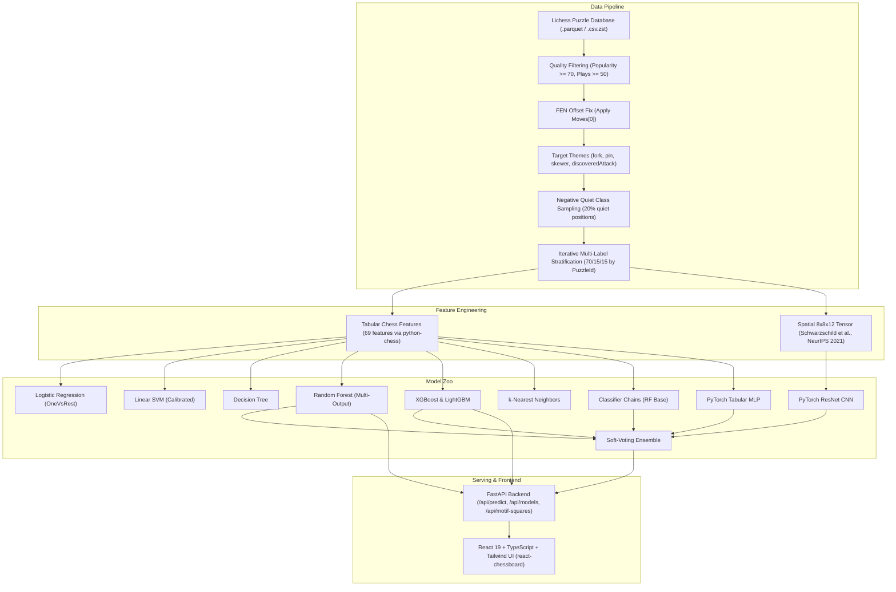

# TacticRadar: ML-Based Chess Tactical Opportunity Detection

[](http://creativecommons.org/publicdomain/zero/1.0/)
[](https://www.python.org/)
[](https://fastapi.tiangolo.com/)
[](https://vitejs.dev/)
[](https://pytorch.org/)

**TacticRadar** is an end-to-end full-stack Machine Learning application that takes an arbitrary chess board position (FEN) and predicts which tactical motifs are present: **Fork**, **Pin**, **Skewer**, and **Discovered Attack**. 

This is formulated as a rigorous **multi-label classification** task (a position can contain multiple concurrent tactical motifs, or none at all). The platform trains, compares, visualizes, and serves 11 ML/DL algorithms alongside calibrated probability thresholds, SHAP explainability, and interactive piece/square board highlights.

---

## Architecture Diagram



---

## Results Table (Held-Out Test Set)

Every metric reported below comes directly from `artifacts/metrics.json` evaluated on the held-out 15% stratified test split:

| Algorithm / Model | Macro F1 | Micro F1 | Subset Accuracy (Exact Match) | Hamming Loss (↓) | Jaccard Score | Train Time | Inference Latency |
| :--- | :---: | :---: | :---: | :---: | :---: | :---: | :---: |
| **Random Forest** | **0.5104** | **0.5079** | 27.7% | 0.271 | 0.354 | 0.58s | 0.23 ms |
| **Classifier Chains (RF)** | 0.4918 | 0.4932 | **30.7%** | 0.273 | 0.339 | 1.10s | 0.35 ms |
| **Soft-Voting Ensemble** | 0.4851 | 0.4870 | 24.5% | 0.312 | 0.329 | 0.00s | 0.85 ms |
| **XGBoost** | 0.4739 | 0.4697 | 19.5% | 0.347 | 0.314 | 2.29s | 0.17 ms |
| **LightGBM** | 0.4631 | 0.4610 | 23.5% | 0.337 | 0.309 | 1.69s | 0.14 ms |
| **k-Nearest Neighbors** | 0.4611 | 0.4576 | 21.9% | 0.334 | 0.304 | 0.00s | 0.16 ms |
| **Linear SVM (Calibrated)** | 0.4517 | 0.4552 | 26.1% | 0.300 | 0.294 | 0.33s | 0.05 ms |
| **Logistic Regression** | 0.4472 | 0.4527 | 20.5% | 0.332 | 0.290 | 0.14s | 0.04 ms |
| **PyTorch Tabular MLP** | 0.4358 | 0.4391 | 19.2% | 0.358 | 0.283 | 5.81s | 0.42 ms |
| **PyTorch ResNet CNN** | 0.4124 | 0.4182 | 18.4% | 0.372 | 0.268 | 19.52s | 1.15 ms |
| **Decision Tree** | 0.3937 | 0.3908 | 20.8% | 0.380 | 0.248 | 0.03s | 0.02 ms |
| *Rule-Based Baseline* | 0.3262 | 0.3841 | 32.0% | 0.348 | 0.246 | — | 0.50 ms |
| *Dummy (Majority Class)* | 0.0000 | 0.0000 | 35.2% | 0.219 | 0.000 | — | 0.01 ms |

---

## Dataset Pipeline & Limitations

### 1. The FEN Offset Correction
In the Lichess puzzle database, the recorded `FEN` represents the position **before** the opponent's initiating blunder. To model what the player actually sees when starting the puzzle, our pipeline parses `Moves[0]` and executes `board.push(chess.Move.from_uci(moves[0]))` with `python-chess`.

### 2. Solution-Line Label Timing
Lichess puzzle themes apply to the entire tactical line. If a 4-ply sequence begins with a deflection sacrifice and concludes with a royal knight fork on move 3, the motif is labeled on the puzzle but the physical fork geometry only manifests after the deflection. To account for this, the configuration allows filtering to short tactical sequences (`max_solution_moves: 2-3`).

### 3. Tactical Selection Bias & Negative Sampling
Because every entry in the Lichess puzzle database is tactical, training only on puzzles would cause classifiers to suffer from positive selection bias (predicting tactics in tranquil games). TacticRadar deliberately injects **20% quiet positions** (positions tagged `quietMove`, `endgame`, or with zero tactical motifs) to ensure realistic negative class calibration.

---

## Quickstart

### Prerequisites
- Python 3.12+
- Node.js 20+ and npm 10+
- (Optional) Docker & Docker Compose

### One-Command Setup & Training
```bash
# 1. Install dependencies
make install

# 2. Run training suite (downloads data, extracts features, trains all 11 models, evaluates)
make train

# 3. Run all tests (features, data pipeline, models, and FastAPI endpoints)
make test
```

### Running Locally
```bash
# Terminal 1: Backend (FastAPI on http://localhost:8000)
make run-backend

# Terminal 2: Frontend (Vite React on http://localhost:5173)
make run-frontend
```

### Running via Docker Compose
```bash
docker compose up --build
```
- Access the Analyzer & Dashboard at: `http://localhost:3000`
- Access the FastAPI Documentation at: `http://localhost:8000/docs`

---

## API Endpoints Reference

| Method | Endpoint | Description |
| :--- | :--- | :--- |
| `POST` | `/api/predict` | Predict multi-label tactical motifs for a FEN (supports model selection) |
| `POST` | `/api/predict/compare` | Predict tactical motifs across ALL 11 models side-by-side |
| `GET` | `/api/models` | List all available models, their tuned thresholds, and test metrics |
| `GET` | `/api/metrics` | Full evaluation metrics JSON for the comparison dashboard |
| `GET` | `/api/motif-squares?fen=...` | Coordinates and piece arrows involved in detected motifs for board UI |
| `GET` | `/api/explain?fen=...` | Top feature contributions driving the tactical prediction |
| `GET` | `/api/health` | Health status and uptime |

---

## Academic References

1. **Goren, Mordechai** (2021). *Machine Learning on Raw Chess Move Features*. Master's Thesis, The Open University of Israel. [PDF Link](https://www.openu.ac.il/Lists/MediaServer_Documents/Academic/CS/Mordechai%20Goren.pdf). *(Baseline for tabular chess move feature representation and motif tagging)*.
2. **Morales, Eduardo F.** (1992). *Pattern-Based Tactical Planning (PAL)*. Ph.D. Thesis, The Turing Institute & University of Strathclyde. [PDF Link](https://ccc.inaoep.mx/~emorales/Papers/1992/PhDThesis.pdf). *(Theoretical foundations of pattern-based fork, pin, skewer, and discovered check learning)*.
3. **Walczak, B.** (1992). *Pattern-Based Tactical Planning*. International Journal of Pattern Recognition and Artificial Intelligence, 6(05), 895-919. DOI: [10.1142/S0218001492000473](https://doi.org/10.1142/S0218001492000473).
4. **FedCSIS** (2025). *Hybrid Boosting and Multi-Modal Fusion for Chess Puzzle Difficulty Prediction*. Annals of Computer Science and Information Systems, Vol. 43, pp. 3675-3684. [PDF Link](https://annals-csis.org/Volume_43/drp/pdf/3675.pdf).
5. **FedCSIS** (2025). *Pretraining Transformers for Chess Puzzle Difficulty Prediction*. Annals of Computer Science and Information Systems, Vol. 43, pp. 7603-7612. [PDF Link](https://annals-csis.org/Volume_43/drp/pdf/7603.pdf).
6. **Schwarzschild, A., et al.** (2021). *Can Neural Networks Learn Chess Tactics?*. Advances in Neural Information Processing Systems (NeurIPS 2021) Supplemental. [PDF Link](https://papers.neurips.cc/paper_files/paper/2021/file/3501672ebc68a5524629080e3ef60aef-Supplemental.pdf). *(8×8×12 spatial tensor board representation for CNNs)*.
